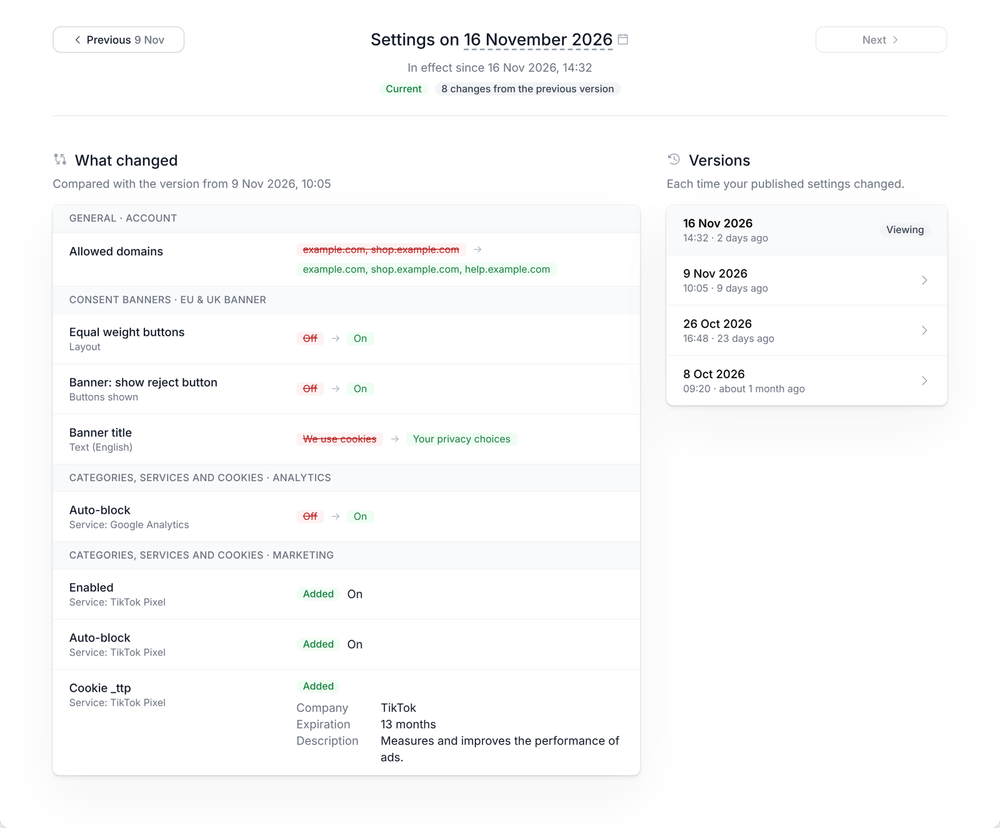

Config Rewind shows the consent configuration your website was serving on any date. Each version is compared with the one before it, so you can see exactly what changed and when.

Open it from **Settings → Config Rewind** in the sidebar, or go to [cookiechimp.com/config-rewind](https://cookiechimp.com/config-rewind).

## How versions are recorded

Each time you publish a change to your banners, categories, services or cookies, CookieChimp keeps a copy of the published configuration. A new version is listed only when something actually changed.

Config Rewind starts from the first configuration recorded for your account. If you pick a date before that, it shows the earliest recorded version.

## Pick a date

Click the date in the heading to open the calendar, then choose a day. Config Rewind shows the configuration that was in effect at the end of that day.

Use **Previous** and **Next** to step between versions. The **Versions** list on the right shows the versions around the one you're viewing. Click any of them to open it.

Times are shown in your time zone, which you can change in your profile settings.

## See what changed

**What changed** lists every setting that differs from the previous version:

- **Changed** settings show the old value and the new value side by side.
- **Added** and **Removed** settings are labelled. A cookie added or removed as a whole is shown once, with its company, expiry and description.

Below that, the full configuration for the date is shown, with changed settings highlighted. Turn on **Only show changed settings** to hide everything that stayed the same.

## What's included

| Section | What you'll see |
| --- | --- |
| General | Default and additional languages, allowed domains (including your main domain), and vendor blocking mode |
| Consent banners | For each banner: behaviour, layout, buttons shown, appearance, colours, and banner and preferences text in every language |
| Categories, services and cookies | For each category: whether it's always on, its name and description, each service's settings, and the cookies and storage items with their descriptions and expiry |

## Good to know

- Config Rewind is read-only. To change a setting, update it in the usual place, such as the [Banner Designer](/features/banner-designer) or [Vendor Management](/features/vendor-management).
- Every team member on the account can open Config Rewind.
- Config Rewind used to be called Settings History. Old links to `/settings-history` redirect to `/config-rewind`.
